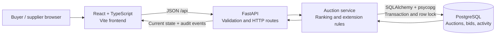

# Architecture

The app is a small RFQ workspace. A buyer creates an auction and suppliers submit itemized quotes. FastAPI owns the auction clock, price validation, supplier ranking, and extension decisions. PostgreSQL persists the bids and audit trail. React displays the current state and polls every five seconds so another supplier's bid or an extension appears without a reload.

## Bid transaction

1. Lock the auction row with `SELECT ... FOR UPDATE`. Every submission to the same RFQ takes the same lock, including submissions from an existing supplier.
2. Read server time after the lock is acquired. Reject unless `start <= now < close` and `now < forced_close`.
3. Load each supplier's latest quote. Normalize supplier identity, check that a replacement quote strictly reduces that supplier's total, and calculate previous rankings.
4. Insert the quote and recompute rankings by total price, then submission time, then ID. Equal totals from different suppliers are allowed.
5. If British Auction is enabled and the submission is in `[close - X, close)`, evaluate the selected trigger against the previous ranking.
6. On a qualifying trigger, update close to `min(close + Y, forced_close)`. Record the bid and any extension event in the same transaction.
7. Commit. Return the updated rankings, timings, and activity log.

A failed submission rolls back the entire transaction. A row lock allows independent auctions to accept bids concurrently while serializing changes to the same auction. Bid writes use PostgreSQL's default Read Committed isolation and per-request sessions. List, detail, and history reads use separate short-lived Repeatable Read sessions so every response comes from one committed snapshot, even when a bid commits between its queries. The write lock must cover the read/compare/write sequence; a client-side countdown cannot enforce closing rules.

## Time and state

All API timestamps include an offset and are normalized to UTC. Forms accept local time and convert it to ISO timestamps. The backend determines status at read time, so no timer process or scheduled job is needed to close auctions.

| Condition | Status |
| --- | --- |
| Current time is before start | Scheduled |
| Start has passed, close has not | Active |
| Current close has passed and is earlier than forced close | Closed |
| Current close reached forced close and that deadline has passed | Force closed |

The original closing time is preserved for audit. Each qualifying bid can extend once, using the current closing time as its base. A request arriving exactly at close is late. At the hard cap a bid can still be accepted before the deadline, but the system records no extension unless the closing time actually changes.

## Trigger semantics

| Trigger | What qualifies inside the window |
| --- | --- |
| Bid received | Any accepted quote |
| Any rank change | A supplier enters the rankings or any current rank changes |
| Lowest bidder change | The identity of L1 changes; a lower quote from the same L1 does not qualify |

The first quote establishes L1 and counts as a rank/L1 change. These choices resolve cases the assignment leaves unspecified.

## Boundaries and tradeoffs

This assignment has no identity or permission model. Supplier names identify bidders case-insensitively; they are not authenticated accounts. A production deployment should bind supplier IDs to authenticated memberships and restrict creation to buyers. The API deliberately returns open bids, as required by the brief.

Currency is INR, represented by fixed-precision decimal values. Quote totals are calculated by the server from freight, origin, and destination charges. A replacement quote must be cheaper than that supplier's previous quote, but need not beat the current leader. Quote validity must cover the service date.

The initial version uses a single API service, connection pooling, polling, and database indexes. Bid history is append-only; there is no deletion or editing endpoint. A larger deployment can add cursor pagination, authenticated roles, WebSocket/SSE updates, and managed schema migrations without changing the auction rules. Current collection reads are intended for assignment-sized data.

No external scheduler, queue, Redis, Docker, or hosted frontend dependency is required. Supply a cloud PostgreSQL URL at runtime. Local test databases are disposable and separate from that URL.

## References

The transaction design follows [PostgreSQL transaction isolation](https://www.postgresql.org/docs/current/transaction-iso.html) and [SQLAlchemy session transactions](https://docs.sqlalchemy.org/en/20/orm/session_transaction.html). The API runs as an ASGI app using [FastAPI's Uvicorn deployment pattern](https://fastapi.tiangolo.com/deployment/manually/).
