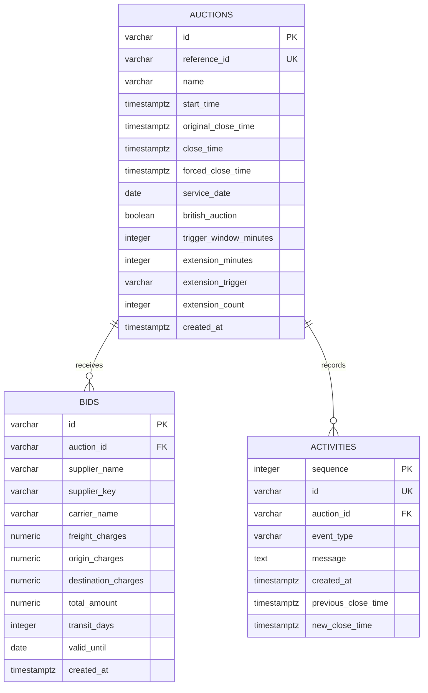

# Database design

PostgreSQL is the source of truth. The SQLAlchemy mappings live in `backend/app/models.py`; `backend/schema.sql` is the equivalent PostgreSQL schema reference. Initialize an empty database with `python -m backend.app.init_db`.

## Auctions

One row per RFQ, with a globally unique reference. `original_close_time` captures the initial deadline and `close_time` advances as the auction extends. Constraints enforce:

- `start_time < original_close_time < forced_close_time`
- `original_close_time <= close_time <= forced_close_time`
- Trigger window and extension duration are positive integers.
- Extension count is nonnegative and the trigger is one of the three supported values.

Status, lowest bid, supplier count, and bid count are derived rather than stored. This avoids stale status when the clock passes a deadline and avoids duplicate summary values drifting from the bid records.

## Bids

Every accepted quote is a new row. Earlier quotes remain available as history. `supplier_key` is the trimmed, case-folded supplier name used for identity; the display name remains in `supplier_name`. There is no unique constraint on `(auction_id, supplier_key)`, because a supplier can revise a quote repeatedly.

Money columns use `NUMERIC(18,2)`; input amounts are limited to 16 digits including decimal places. Three maximum-sized charge components still fit the total column. Database checks require nonnegative charges, a positive total equal to their sum, and positive transit days. The API additionally rejects more than two decimal places, invalid validity dates, and replacements that do not strictly decrease a supplier's previous total.

The composite index `(auction_id, supplier_key, created_at)` supports auction lookups and quote history. Current quotes are selected per supplier and ranked by `(total_amount, created_at, id)`. API decimal values are serialized as strings to preserve precision.

## Activities

An event records creation, bid submission, or a closing-time extension. Extension events include the previous and new close timestamps and a human-readable reason. Events share the bid transaction, so a bid cannot be committed without its audit event or its required extension.

`sequence` is an internal increasing integer used to order events when timestamps match. `id` is the public unique identifier. `auction_id` is indexed; activity queries return newest events first. Both foreign keys use `ON DELETE CASCADE`, although the application does not expose deletion.

## Consistency

The auction row acts as the serialization point for submissions. Each submission locks that row before loading previous quotes, validating the deadline, or calculating rankings. All participating API instances use the database lock, so the rule holds across workers. A bid on another RFQ takes a different row lock.

The original and extended timestamps use `TIMESTAMPTZ`. Service and validity dates are plain calendar dates. Event and bid timestamps come from server UTC time. An authenticated supplier table would replace name-based identity when adding user accounts; it is outside this assignment's scope.
